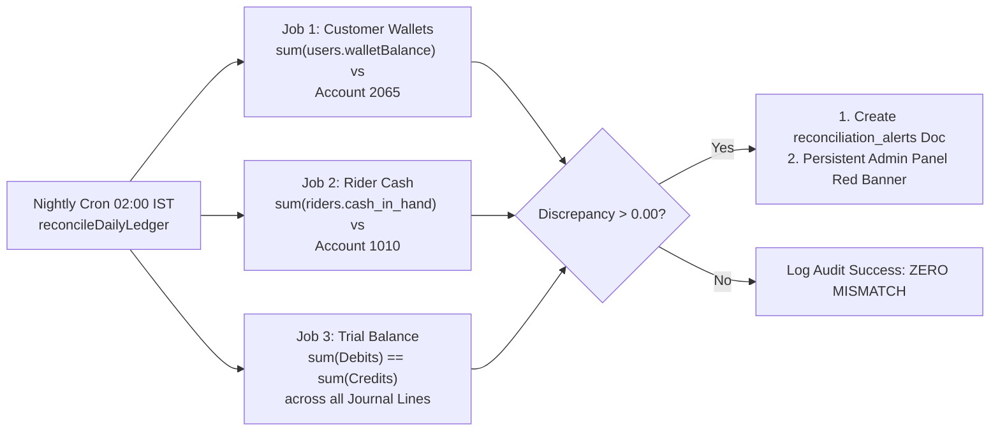

# Phase 1: Unified Financial Architecture & Wallet System Design
**Project:** KrishiVishal (`krishivishal-a9ed7`)  
**Document Version:** 2.1.0-PROD-DESIGN  
**Date:** 2026-10-14  
**Author:** KrishiVishal Senior Fintech & Backend Architecture Team  
**Status:** DRAFT PROPOSAL FOR FOUNDER & STATUTORY AUDITOR (CA) APPROVAL  

---

## Executive Summary & Core Architectural Tenets

This design establishes a statutory, audit-grade, double-entry financial architecture across the entire KrishiVishal ecosystem (Customer App, Delivery Partner App, Admin Back-Office, and Cloud Functions). 

```
┌─────────────────────────────────────────────────────────────────────────────┐
│                          KRISHIVISHAL UNIFIED LEDGER                        │
│                   (System 2: journal_entries + atomic lines)                │
└──────▲──────────────────────────────▲──────────────────────────────▲────────┘
       │                              │                              │
┌──────┴──────────────┐     ┌─────────┴────────────┐     ┌───────────┴────────┐
│   CUSTOMER WALLET   │     │  RIDER CASH & VAULT  │     │   COMPANY BANK     │
│ (Store Credit / P2M)│     │  (Field Collections) │     │ (HDFC Main Account)│
│  users.walletBalance│     │  riders.cash_in_hand │     │  Cash & Gateways   │
└─────────────────────┘     └──────────────────────┘     └────────────────────┘
```

### Core Architecture Invariants
1. **Single Source of Truth:** System 2 ([`finance/generalLedger.js`](file:///C:/Users/visha/AndroidStudioProjects/KrishiVishal_GITCLONE/KrishiVishal-Functions/finance/generalLedger.js) $\rightarrow$ `journal_entries` with atomic subcollection `lines`) is the sole financial authority. System 1 ([`finance/ledger.js`](file:///C:/Users/visha/AndroidStudioProjects/KrishiVishal_GITCLONE/KrishiVishal-Functions/finance/ledger.js) / root `ledger` / `accounts`) is permanently frozen for new writes once System 2 replacements are live.
2. **Double-Entry Equation (Ind AS / AS):** Every monetary mutation (wallet credit/debit, cash collection, settlement, shortage, payout) must balance arithmetic debits and credits:
   $$\sum \text{Debits} \equiv \sum \text{Credits}$$
3. **Strict Idempotency:** Every financial journal entry and wallet mutation is governed by a deterministic, unrepeatable idempotency key (`linesHash` + composite entry ID).
4. **ACID Ledger Integrity:** Customer and rider balance field mutations (`users/{uid}.walletBalance`, `riders/{id}.cash_in_hand`) must execute inside atomic Firestore transactions coordinated with ledger entries.
5. **No Client Trust:** Zero client-side writes to financial balances, transaction collections, or ledger entries (`allow write: if false;`).

---

## 0. Resolution of Pre-requisites (Phase 0.5 Closeout)

### 0.1 Verification of `markCashAsDeposited` (Kotlin Android Delivery App)
* **Location in Code:** [`KrishiVishalDelivery/app/src/main/java/com/company/krishivishaldelivery/data/repository/OrderRepository.kt:871`](file:///c:/Users/visha/AndroidStudioProjects/KrishiVishal_GITCLONE/../KrishiVishalDelivery/app/src/main/java/com/company/krishivishaldelivery/data/repository/OrderRepository.kt#L871)
* **ViewModel Wrapper:** [`KrishiVishalDelivery/app/src/main/java/com/company/krishivishaldelivery/ui/dashboard/DashboardViewModel.kt:325`](file:///c:/Users/visha/AndroidStudioProjects/KrishiVishal_GITCLONE/../KrishiVishalDelivery/app/src/main/java/com/company/krishivishaldelivery/ui/dashboard/DashboardViewModel.kt#L325)
* **UI Screen Callers:** **NONE (0 callers found).** Targeted grep across the entire UI layer confirms that the UI exclusively calls the `settleRiderCash` callable function.
* **Finding:** `markCashAsDeposited` is **dead/orphan code**. It directly attempts a client-side Firestore write to `orders/{orderId}` with `depositStatus: "DEPOSITED"`. It will be scheduled for removal in Package 4.

### 0.2 Emulator Security Rules Test Suite Baseline
* **Suite Result:** Total 80 tests $\rightarrow$ 76 Passed, 4 Failed.
* **Specific Failures:** `4.1`, `10.6`, `10.7`, `10.12` (all 4 are legacy rider order self-assignment tests that failed because dispatch moved to backend server-side assignment).
* **Finding:** **Zero failures exist in the financial, wallet, payout, or ledger rules suites.**

---

## Section A: Chart of Accounts (CoA) Master Structure

The Chart of Accounts in [`KrishiVishal-Functions/finance/generalLedger.js:11-56`](file:///C:/Users/visha/AndroidStudioProjects/KrishiVishal_GITCLONE/KrishiVishal-Functions/finance/generalLedger.js#L11) is expanded in design to support granular wallet, cash-in-hand, vault, shortage receivable, and promo liability accounting.

| Account Code | Account Display Name | Category | Normal Balance | Statutory Purpose (Schedule III Ind AS) |
| :--- | :--- | :--- | :--- | :--- |
| **`1010_CASH_IN_HAND_RIDERS`** | Cash in Hand - Delivery Fleet | CURRENT_ASSET | DEBIT | Undeposited COD cash physically collected by riders |
| **`1015_RIDER_RECEIVABLE_SHORTAGES`** *(NEW)* | Rider Cash Shortage Receivable | CURRENT_ASSET | DEBIT | Cash shortage exceeding accrued earnings recoverable from rider |
| **`1020_HUB_CASH_VAULT`** | Hub Cash Vault / Safe | CURRENT_ASSET | DEBIT | Physical cash surrendered by riders stored in hub safe |
| **`1030_BANK_CURRENT_HDFC`** | HDFC Current Account (Main Op) | BANK_ACCOUNT | DEBIT | Primary corporate operating bank account |
| **`1040_INVENTORY_MAIN_HUB`** | Inventory Stock - Main Hub | INVENTORY | DEBIT | Physical agri-input stock valuation |
| **`1050_GATEWAY_RECEIVABLE`** | Razorpay Clearing & Receivable | CURRENT_ASSET | DEBIT | Unsettled customer digital prepayments held at gateway |
| **`1060_INPUT_CGST`** | Input Tax Credit - CGST | TAX_ASSET | DEBIT | Input tax credit on procurement and expenses |
| **`1070_INPUT_SGST`** | Input Tax Credit - SGST | TAX_ASSET | DEBIT | Input tax credit on procurement and expenses |
| **`1080_INPUT_IGST`** | Input Tax Credit - IGST | TAX_ASSET | DEBIT | Inter-state Input tax credit |
| **`2010_ACCOUNTS_PAYABLE_SUPPLIERS`** | Accounts Payable - Agri Suppliers | CURRENT_LIABILITY | CREDIT | Trade payables owed to seed/fertilizer suppliers |
| **`2015_RIDER_PAYOUTS_PAYABLE`** | Accrued Delivery Partner Payouts | CURRENT_LIABILITY | CREDIT | Weekly earned delivery fees owed to riders |
| **`2020_OUTPUT_CGST_PAYABLE`** | Output CGST Payable | DUTIES_AND_TAXES | CREDIT | CGST collected on customer sales invoices |
| **`2030_OUTPUT_SGST_PAYABLE`** | Output SGST Payable | DUTIES_AND_TAXES | CREDIT | SGST collected on customer sales invoices |
| **`2040_OUTPUT_IGST_PAYABLE`** | Output IGST Payable | DUTIES_AND_TAXES | CREDIT | IGST collected on customer sales invoices |
| **`2050_TDS_PAYABLE_194C`** | TDS Payable (Sec 194C / Contractor) | DUTIES_AND_TAXES | CREDIT | Tax withheld on contractor / rider payouts |
| **`2060_CUSTOMER_REFUNDS_PAYABLE`** | Customer Refunds Payable Clearing | CURRENT_LIABILITY | CREDIT | Central clearing account for approved credit note liabilities |
| **`2065_CUSTOMER_WALLET_LIABILITY`** *(NEW)* | Customer Wallet Store Credit Liability | CURRENT_LIABILITY | CREDIT | Total outstanding customer wallet balances (store credit) |
| **`2070_DEFERRED_REVENUE`** | Deferred Revenue (Unfulfilled Orders)| CURRENT_LIABILITY | CREDIT | Advance customer receipts pending delivery fulfillment |
| **`3010_SHARE_CAPITAL`** | Paid-up Share Capital | SHARE_CAPITAL | CREDIT | Equity capital introduced into business |
| **`3020_RETAINED_EARNINGS`** | Retained Earnings / Reserves | RESERVES_AND_SURPLUS| CREDIT | Cumulative P&L surplus / deficit (CA determines opening plug) |
| **`4010_SALES_AGRI_INPUTS`** | Sales of Agri-Inputs | OPERATING_REVENUE | CREDIT | Revenue from seeds, agrochemicals, fertilizers |
| **`4020_DELIVERY_INCOME`** | Customer Delivery Fees Income | OPERATING_REVENUE | CREDIT | Delivery convenience fees charged to customers |
| **`5010_COGS_AGRI_INPUTS`** | Cost of Goods Sold | DIRECT_EXPENSE | DEBIT | Cost of goods sold for delivered inventory |
| **`6010_RIDER_DELIVERY_PAYOUTS`** | Rider Delivery Trip Fees | OPERATING_EXPENSE | DEBIT | Direct fulfillment and trip payout expense |
| **`6020_PAYMENT_GATEWAY_FEES`** | Razorpay Merchant Discount Rate (MDR)| FINANCIAL_EXPENSE | DEBIT | Merchant processing fees charged by gateway |
| **`6030_REFERRAL_PROMOTION_EXPENSE`** *(NEW)*| Customer Referral & Marketing Credit| OPERATING_EXPENSE | DEBIT | Marketing expense for customer referral promotions |
| **`6035_CUSTOMER_GOODWILL_EXPENSE`** *(NEW)*| Customer Dispute & Goodwill Concessions | OPERATING_EXPENSE | DEBIT | Discretionary admin goodwill compensation |
| **`6040_CASH_SHORTAGE_LOSS`** *(NEW)* | Hub & Transit Cash Shortage Loss | OPERATING_EXPENSE | DEBIT | Write-off expense for unresolved physical cash shortages |

---

## Section B: Event-Driven Journal Entries & Idempotency Key Architecture

### B.1 Two-Step Statutory Refund Architecture (Credit Note → Settlement)

Refunds are partitioned into two decoupled, verifiable steps with distinct idempotency keys:

```
[Customer Return / Cancellation Approved]
                   │
                   ▼ (Step 1: Statutory Invoicing Reversal via creditNoteEngine.js)
     Debit 4010_SALES_AGRI_INPUTS (Taxable Value)
     Debit 2020_OUTPUT_CGST_PAYABLE (CGST Reversal)
     Debit 2030_OUTPUT_SGST_PAYABLE (SGST Reversal)
     Credit 2060_CUSTOMER_REFUNDS_PAYABLE (Full Invoice Value)
     [If restockable: Debit 1040_INVENTORY_MAIN_HUB | Credit 5010_COGS_AGRI_INPUTS]
                   │
                   ├──► Settlement Path A (Customer Wallet / COD Return):
                   │    Debit 2060_CUSTOMER_REFUNDS_PAYABLE
                   │    Credit 2065_CUSTOMER_WALLET_LIABILITY
                   │
                   └──► Settlement Path B (Online Razorpay Payment):
                        1. Initiate Razorpay API refund (Status: INITIATED)
                        2. Webhook refund.processed arrives:
                           Debit 2060_CUSTOMER_REFUNDS_PAYABLE
                           Credit 1050_GATEWAY_RECEIVABLE
                        3. Webhook refund.failed arrives:
                           Status: FAILED. 2060 remains open for alert/retry.
```

#### Step 1: Statutory Credit Note Issuance (`invoices/creditNoteEngine.js:480-530`)
* **Debit:** `4010_SALES_AGRI_INPUTS` (Taxable base amount)
* **Debit:** `2020_OUTPUT_CGST_PAYABLE` (CGST amount)
* **Debit:** `2030_OUTPUT_SGST_PAYABLE` (SGST amount)
* **Credit:** `2060_CUSTOMER_REFUNDS_PAYABLE` (Total refund amount)
* **If Restockable Inventory (`restockable === true`):**
  * **Debit:** `1040_INVENTORY_MAIN_HUB` (Cost of goods)
  * **Credit:** `5010_COGS_AGRI_INPUTS` (Cost of goods)
* **Distinct Idempotency Key:** `JE_CREDIT_NOTE_${creditNoteNumber}`

#### Step 2A: Wallet Settlement (For Wallet Orders & COD Returns as Store Credit)
*Trigger:* Executed immediately after Step 1 for store credit.
* **Debit:** `2060_CUSTOMER_REFUNDS_PAYABLE`
* **Credit:** `2065_CUSTOMER_WALLET_LIABILITY`
* **Distinct Idempotency Key:** `JE_SETTLEMENT_WALLET_${creditNoteNumber}`
* **Firestore Mutation:** Inside `runTransaction`: Increment `users/{uid}.walletBalance` by $+₹Refund$, insert `wallet_transactions` record.

#### Step 2B: Online Razorpay Settlement (For Razorpay Prepaid Orders)
*Trigger:* Asynchronous settlement through Razorpay Gateway.
* **Phase 1: Initiation:** Callable triggers Razorpay Refund API. Creates document `refund_requests/{refundId}` with `status: "INITIATED"`, storing `razorpayRefundId`.
* **Phase 2: Confirmation (`refund.processed` Webhook):**
  * **Debit:** `2060_CUSTOMER_REFUNDS_PAYABLE`
  * **Credit:** `1050_GATEWAY_RECEIVABLE`
  * **Distinct Idempotency Key:** `JE_SETTLEMENT_GATEWAY_${razorpayRefundId}`
  * Document updated to `status: "PROCESSED"`.
* **Phase 3: Failure Handling (`refund.failed` Webhook):**
  * Webhook records failure reason in `refund_requests/{refundId}` with `status: "FAILED"`.
  * `2060_CUSTOMER_REFUNDS_PAYABLE` remains untouched (liability stays open).
  * Raises alert to FinanceAdmin dashboard to re-trigger or offer alternative settlement.

#### Proof of Zero Double Reversal:
Sales revenue (`4010`) and GST accounts (`2020`/`2030`) are debited **exclusively in Step 1** via `creditNoteEngine`. Step 2 only debits the intermediate liability `2060` and credits the respective discharge account (`2065` or `1050`). Step 2 cannot touch revenue or tax accounts, mathematically eliminating duplicate reversals.

---

### B.2 Comprehensive Refund Matrix Across Payment Modes

| Payment Mode of Order | Return / Cancel Scenario | Destination of Refunded Money | Double-Entry Journal Entry | Idempotency Key Format | Statutory & Regulatory Note (Subject to CA / Legal Counsel Verification) |
| :--- | :--- | :--- | :--- | :--- | :--- |
| **Wallet** | Order Cancelled (Pre-dispatch) | Customer Wallet (`users.walletBalance`) | **Step 1:**<br/>Dr `2070_DEFERRED_REVENUE`<br/>Cr `2060_CUSTOMER_REFUNDS_PAYABLE`<br/>**Step 2:**<br/>Dr `2060_CUSTOMER_REFUNDS_PAYABLE`<br/>Cr `2065_CUSTOMER_WALLET_LIABILITY` | `JE_CREDIT_NOTE_CANCEL_${orderId}`<br/>+<br/>`JE_SETTLEMENT_WALLET_${orderId}` | Closed system balance restoration. Zero external cash movement. |
| **Wallet** | Item Returned (Delivered) | Customer Wallet (`users.walletBalance`) | **Step 1 (Credit Note):**<br/>Dr `4010_SALES_AGRI_INPUTS`<br/>Dr `2020`/`2030_OUTPUT_GST`<br/>Cr `2060_CUSTOMER_REFUNDS_PAYABLE`<br/>(Dr `1040` / Cr `5010` if restocked)<br/>**Step 2 (Settlement):**<br/>Dr `2060_CUSTOMER_REFUNDS_PAYABLE`<br/>Cr `2065_CUSTOMER_WALLET_LIABILITY` | `JE_CREDIT_NOTE_${creditNoteNo}`<br/>+<br/>`JE_SETTLEMENT_WALLET_${creditNoteNo}` | Reverses taxable supply under statutory credit note rules (counsel/CA verify karega). |
| **Razorpay (Prepaid Online)** | Order Cancelled (Pre-dispatch) | Original Source Bank / UPI via Razorpay API | **Step 1:**<br/>Dr `2070_DEFERRED_REVENUE`<br/>Cr `2060_CUSTOMER_REFUNDS_PAYABLE`<br/>**Step 2 (On Webhook):**<br/>Dr `2060_CUSTOMER_REFUNDS_PAYABLE`<br/>Cr `1050_GATEWAY_RECEIVABLE` | `JE_CREDIT_NOTE_CANCEL_${orderId}`<br/>+<br/>`JE_SETTLEMENT_GATEWAY_${razorpayRefundId}` | **Does NOT touch Customer Wallet.** Cleared directly through Razorpay clearing account. |
| **Razorpay (Prepaid Online)** | Item Returned (Delivered) | Original Source Bank / UPI via Razorpay API | **Step 1 (Credit Note):**<br/>Dr `4010_SALES_AGRI_INPUTS`<br/>Dr `2020`/`2030_OUTPUT_GST`<br/>Cr `2060_CUSTOMER_REFUNDS_PAYABLE`<br/>(Dr `1040` / Cr `5010` if restocked)<br/>**Step 2 (On Webhook):**<br/>Dr `2060_CUSTOMER_REFUNDS_PAYABLE`<br/>Cr `1050_GATEWAY_RECEIVABLE` | `JE_CREDIT_NOTE_${creditNoteNo}`<br/>+<br/>`JE_SETTLEMENT_GATEWAY_${razorpayRefundId}` | Source return aligns with consumer protection principles (counsel/CA verify karega). |
| **Cash on Delivery (COD)** | Item Returned (Delivered) | Customer Wallet as Store Credit (`walletBalance`) | **Step 1 (Credit Note):**<br/>Dr `4010_SALES_AGRI_INPUTS`<br/>Dr `2020`/`2030_OUTPUT_GST`<br/>Cr `2060_CUSTOMER_REFUNDS_PAYABLE`<br/>(Dr `1040` / Cr `5010` if restocked)<br/>**Step 2 (Settlement):**<br/>Dr `2060_CUSTOMER_REFUNDS_PAYABLE`<br/>Cr `2065_CUSTOMER_WALLET_LIABILITY` | `JE_CREDIT_NOTE_${creditNoteNo}`<br/>+<br/>`JE_SETTLEMENT_WALLET_${creditNoteNo}` | **Regulatory Note:** Legal counsel to verify whether customer consent for store credit is required. |

---

### B.3 Other Wallet Events & Admin Adjustments

#### 1. Referral Promotion Bonus Credit
*Trigger:* Referred user completes first qualifying order.
* **Debit:** `6030_REFERRAL_PROMOTION_EXPENSE`
* **Credit:** `2065_CUSTOMER_WALLET_LIABILITY`
* **Idempotency Key:** `JE_WALLET_REFERRAL_${referrerUid}_${refereeUid}`

#### 2. Referral Promotion Reversal on Order Cancellation (Simplified Clawback)
*Trigger:* Referee cancels their qualifying order after referrer has received bonus credit (₹B).
* **Policy Decision:**
  - Clawback is strictly limited to the referrer's **currently available wallet balance**.
  - Any remaining unrecovered deficit is **written off** immediately as promotional cost.
  - Deficit is **NOT** carried forward, **NOT** booked as an asset receivable (no `1055`), and **NOT** offset against future wallet refunds or top-ups.
* **Accounting Treatment:**
  - Recoverable amount $R = \min(\text{currentBalance}, B)$.
  - If $R > 0$:
    - **Debit:** `2065_CUSTOMER_WALLET_LIABILITY` ₹$R$
    - **Credit:** `6030_REFERRAL_PROMOTION_EXPENSE` ₹$R$
    - *Idempotency Key:** `JE_WALLET_REFERRAL_REVERSAL_${orderId}_${referrerUid}`
  - If $R < B$:
    - The difference $(B - R)$ was already expensed to `6030` and consumed. It stays as an operational marketing write-off. No negative balance is created.

#### 3. Admin Goodwill Credit
*Trigger:* SuperAdmin/FinanceAdmin grants goodwill compensation for crop advice or service issue.
* **Debit:** `6035_CUSTOMER_GOODWILL_EXPENSE`
* **Credit:** `2065_CUSTOMER_WALLET_LIABILITY`
* **Idempotency Key:** `JE_WALLET_ADMIN_CREDIT_${uid}_${auditRequestId}`

#### 4. Admin Goodwill Clawback / Debit
*Trigger:* SuperAdmin revokes an accidental or duplicate goodwill credit.
* **Debit:** `2065_CUSTOMER_WALLET_LIABILITY`
* **Credit:** `6035_CUSTOMER_GOODWILL_EXPENSE`
* **Idempotency Key:** `JE_WALLET_ADMIN_DEBIT_${uid}_${auditRequestId}`
* **Constraint:** Strictly asserts `currentBalance >= clawbackAmount`. Zero negative balances permitted.

#### 5. Wallet Service Event Contracts & Required Entity Identifiers

Every invocation of `walletService` must supply valid, non-empty business identifiers corresponding to the specific event domain. Replay attempts with matching idempotency keys are verified for parameter consistency; any collision on `uid`, `amount` (or `requestedAmount`), or `type` throws `IDEMPOTENCY_CONFLICT`.

| Event Type | Direction | Required Business Entity Fields | Debit Account | Credit Account | Replay & Partial Mode Rules |
| :--- | :---: | :--- | :--- | :--- | :--- |
| `TOPUP` | `CREDIT` | `topUpId` | `1050_GATEWAY_RECEIVABLE` | `2065_CUSTOMER_WALLET_LIABILITY` | Controlled by `ENABLE_WALLET_TOPUP` kill switch. |
| `ORDER_PAYMENT` | `DEBIT` | `orderId` | `2065_CUSTOMER_WALLET_LIABILITY` | `2070_DEFERRED_REVENUE` | Strict floor check ($balance - amount \ge 0$). Fails with `INSUFFICIENT_WALLET_BALANCE`. |
| `ORDER_REFUND` | `CREDIT` | `returnId` or `creditNoteNumber` | `2060_CUSTOMER_REFUNDS_PAYABLE` | `2065_CUSTOMER_WALLET_LIABILITY` | Closed loop refund to wallet store credit. |
| `REFERRAL_REWARD` | `CREDIT` | `referrerUid`, `refereeUid`, `orderId` | `6030_REFERRAL_PROMOTION_EXPENSE` | `2065_CUSTOMER_WALLET_LIABILITY` | Deterministic key: `JE_WALLET_REFERRAL_${referrerUid}_${refereeUid}_${orderId}`. |
| `REFERRAL_REVERSAL` | `DEBIT` | `referrerUid`, `refereeUid`, `orderId` | `2065_CUSTOMER_WALLET_LIABILITY` | `6030_REFERRAL_PROMOTION_EXPENSE` | **Partial Mode:** Claw back $\min(\text{bonus}, \text{balance})$. If balance is 0, zero JE posted, `wallet_transactions` records $amount=0, requested=bonus, reversed=0$. |
| `ADMIN_CREDIT` | `CREDIT` | `idempotencyKey` (explicit or 60s hash) | `6035_CUSTOMER_GOODWILL_EXPENSE` | `2065_CUSTOMER_WALLET_LIABILITY` | SuperAdmin / FinanceAdmin only. Cap ₹5,000. Min 10-char reason. |
| `ADMIN_DEBIT` | `DEBIT` | `idempotencyKey` (explicit or 60s hash) | `2065_CUSTOMER_WALLET_LIABILITY` | `6035_CUSTOMER_GOODWILL_EXPENSE` | SuperAdmin / FinanceAdmin only. Strict floor check (no overdraft). Cap ₹5,000. |

#### 6. Wallet Order Payment Consolidation Plan (`payWithWallet` vs `createOrder`)
* **Single Canonical Flow:** `createOrder` (with `paymentMethod: 'WALLET'`) is designated as the **exclusive canonical path** for paying with wallet. Inventory allocation, order creation, wallet debit, and deferred revenue journal entry execute in a **single atomic transaction**.
* **Deprecation of `payWithWallet`:** The standalone callable `payWithWallet` will be deprecated for checkout. If retained for payment retries on unfulfilled orders, it will execute the exact unified transaction contract with `JE_WALLET_ORDER_PAYMENT_${orderId}`.

---

### B.4 Rider Cash, Shortage & Earnings Architecture

#### 1. COD Delivery (Cash in Hand Accrual)
*Trigger:* Rider marks order DELIVERED and inputs collected cash amount.
* **Debit:** `1010_CASH_IN_HAND_RIDERS` (Rider asset obligation increases)
* **Credit:** `4010_SALES_AGRI_INPUTS` + Output Taxes
* **Idempotency Key:** `JE_COD_DELIVERY_${orderId}`
* **Firestore Mutation:** Atomic increment of `riders/{riderId}.cash_in_hand` $+₹Collected$.

#### 2. Rider Earnings Lifecycle (Accrual, True-Up & Timing)
* **Per-Delivery Accrual (Trip Fee):**
  * *Trigger:* Order marked `DELIVERED` in `updateOrderStatus`.
  * *Amount:* Contracted trip fee per order (e.g. ₹50 base fee).
  * *Entry:*
    * **Debit:** `6010_RIDER_DELIVERY_PAYOUTS`
    * **Credit:** `2015_RIDER_PAYOUTS_PAYABLE`
    * *Idempotency Key:** `JE_RIDER_ACCRUAL_ORDER_${orderId}`
* **Weekly Earnings True-Up Entry:**
  * *Trigger:* Tuesday morning when `calculateRiderPayout` aggregates weekly performance (distance tiers, peak incentives, slab bonuses, minimum guarantees).
  * *Variance Handling:*
    - If calculated weekly gross $>$ sum of daily trip accruals:
      * **Debit:** `6010_RIDER_DELIVERY_PAYOUTS` (Variance $\Delta$)
      * **Credit:** `2015_RIDER_PAYOUTS_PAYABLE` (Variance $\Delta$)
      * *Idempotency Key:** `JE_RIDER_TRUEUP_POSITIVE_${payoutBatchId}_${riderId}`
    - If calculated weekly gross $<$ sum of daily trip accruals:
      * **Debit:** `2015_RIDER_PAYOUTS_PAYABLE` (Variance $\Delta$)
      * **Credit:** `6010_RIDER_DELIVERY_PAYOUTS` (Variance $\Delta$)
      * *Idempotency Key:** `JE_RIDER_TRUEUP_NEGATIVE_${payoutBatchId}_${riderId}`
* **Rider Penalties & Incentives:**
  * *Delivery Penalty (SLA breach / damage):*
    - **Debit:** `2015_RIDER_PAYOUTS_PAYABLE`
    - **Credit:** `6010_RIDER_DELIVERY_PAYOUTS`
    - *Idempotency Key:** `JE_RIDER_PENALTY_${riderId}_${penaltyId}`
  * *Peak / Surge Incentive:*
    - **Debit:** `6010_RIDER_DELIVERY_PAYOUTS`
    - **Credit:** `2015_RIDER_PAYOUTS_PAYABLE`
    - *Idempotency Key:** `JE_RIDER_INCENTIVE_${riderId}_${incentiveId}`
  * *RTO / Return Trip Fee:*
    - If rider is compensated for returning rejected goods to hub:
      - **Debit:** `6010_RIDER_DELIVERY_PAYOUTS`
      - **Credit:** `2015_RIDER_PAYOUTS_PAYABLE`
      - *Idempotency Key:** `JE_RIDER_RTO_COMMISSION_${orderId}_${riderId}`
* **Timing of Payouts:**
  * *Weekly Trip Payouts:* Calculated every Monday 23:59 IST, approved and disbursed Tuesday morning via `approveRiderPayout`.
  * *Fixed Monthly Pay (Dedicated Staff / Retainers):* Accrued on the last calendar day of the month and disbursed with the first Tuesday payout cycle of the succeeding month.

#### 3. Hub Cash Settlement with Shortage (Single Deduction Point Resolution)
*Trigger:* Rider deposits physical cash at Hub. Hub Manager calls `confirmCashSettlement`.
* **Settlement Time Entry (`confirmCashSettlement`):**
  Shortage is NOT deducted from earnings at daily settlement. It is transferred from transit cash to shortage receivable:
  * **Debit:** `1020_HUB_CASH_VAULT` ₹4,800 (Actual physical cash placed into vault)
  * **Debit:** `1015_RIDER_RECEIVABLE_SHORTAGES` ₹200 (Shortage booked as asset receivable)
  * **Credit:** `1010_CASH_IN_HAND_RIDERS` ₹5,000 (Rider cash in hand cleared)
  * *Idempotency Key:** `JE_HUB_SETTLEMENT_SHORTAGE_${settlementId}`
  * *Rider Document Update:* `riders/{id}.update({ pendingShortageAmount: FieldValue.increment(200) })`.

#### 4. Weekly Payout Run (`approveRiderPayout`): Single Point of Deduction
*Trigger:* Tuesday automated weekly payout batch execution.
* **Calculation:**
  $$\text{Net Payout} = \text{Gross Accrued Earnings} - \text{Pending Shortage Deductions} - \text{TDS (Sec 194C)}$$
* **Entry (When Accrued Earnings $\ge$ Shortage):**
  * **Debit:** `2015_RIDER_PAYOUTS_PAYABLE` (Gross earnings, e.g. ₹1,000)
  * **Credit:** `1015_RIDER_RECEIVABLE_SHORTAGES` (Deduction of shortage, e.g. ₹200)
  * **Credit:** `2050_TDS_PAYABLE_194C` (If applicable, 1% TDS, e.g. ₹10)
  * **Credit:** `1030_BANK_CURRENT_HDFC` (Net bank payout disbursed, e.g. ₹790)
  * *Idempotency Key:** `JE_RIDER_WEEKLY_PAYOUT_${payoutBatchId}_${riderId}`
* **Entry (When Accrued Earnings $<$ Shortage - e.g. Earnings ₹100, Shortage ₹200):**
  * **Debit:** `2015_RIDER_PAYOUTS_PAYABLE` ₹100
  * **Credit:** `1015_RIDER_RECEIVABLE_SHORTAGES` ₹100
  * *Remaining Deficit:* ₹100 remains in `1015_RIDER_RECEIVABLE_SHORTAGES` and `riders/{id}.pendingShortageAmount`, carried forward to the next cycle. Zero negative payout bank transfers.

#### 5. postJournalEntry Transaction Contract (Caller ACID & Ordering Guidelines)

To maintain ACID integrity across Firestore and Google Cloud Firestore SDK transactional constraints, all caller functions (e.g. `walletService`, `creditNoteEngine`, `riderPayoutEngine`) passing a caller-managed transaction `tx` into `postJournalEntry` must adhere to the following 4 statutory contract rules:

1. **Rule 1 (All Caller Reads First):** The caller must perform all required `tx.get()` calls (e.g., fetching current user balance `users/{uid}`, checking order status `orders/{orderId}`) before invoking `postJournalEntry` or performing any writes.
2. **Rule 2 (Zero Writes Before `postJournalEntry`):** The caller must **NEVER** stage any write (`tx.set`, `tx.update`, `tx.delete`) prior to calling `postJournalEntry`. Because `postJournalEntry` must read the fiscal period (`assertFiscalPeriodUnlocked`) and check existing entry idempotency via `tx.get(entryRef)`, any preceding write triggers Firestore's native constraint:
   $$\text{"Firestore transactions require all reads to be executed before all writes"}$$
   *(Empirically proven & verified against the real Firestore Emulator in Test suite `tests/package1_ledger_pass_through.test.js` Test (e)).* All caller writes must be staged strictly **after** `postJournalEntry` resolves.
3. **Rule 3 (Replay Skip on `alreadyProcessed`):** If `postJournalEntry` returns `{ success: true, alreadyProcessed: true }`, the caller **MUST SKIP** subsequent balance mutations and state transitions. Replays must return the existing state idempotently without double-mutating balances.
4. **Rule 4 (Deterministic `entryId` / Idempotency Key):** Callers must always provide a stable, deterministic `entryId` (e.g., `JE_WALLET_ORDER_PAYMENT_${orderId}`, `JE_REFUND_SETTLE_${returnId}`) rather than random UUIDs to ensure full replay deduplication.
5. **Rule 5 (Single Journal Entry Per Transaction - No Multi-JE Transactions):** Exactly one `postJournalEntry` call is permitted per Firestore transaction. Calling `postJournalEntry` a second time inside the same transaction attempts to read the fiscal period (`tx.get(periodRef)`) and entry lock (`tx.get(entryRef)`) after the first call has already staged writes (`tx.set`), which triggers Firestore SDK's fatal constraint:
   $$\text{"Firestore transactions require all reads to be executed before all writes"}$$
   *(Empirically proven & verified against the real Firestore Emulator in Test suite `tests/package1_ledger_pass_through.test.js` Test (f)).* Multi-step financial workflows (such as Two-Step Refund: Step 1 Credit Note issuance $\rightarrow$ Step 2 Settlement) **MUST** execute as two separate, sequential transactions.

---

## Section C: End-to-End Cash Lifecycle & System 1 Decommissioning

### C.1 The End-to-End Cash Highway in System 2

```mermaid
flowchart TD
    A["Customer Hands COD Cash"] -->|Order Delivered| B["Rider Cash in Hand<br/>1010_CASH_IN_HAND_RIDERS<br/>(+riders.cash_in_hand)"]
    B -->|Daily Hub Surrender| C{"Hub Manager Verification<br/>(confirmCashSettlement)"}
    C -->|Exact Cash| D["Hub Cash Vault<br/>1020_HUB_CASH_VAULT<br/>(-riders.cash_in_hand)"]
    C -->|Shortage Detected| E["Book Receivable<br/>1015_RIDER_RECEIVABLE_SHORTAGES<br/>(+pendingShortageAmount)"]
    E --> D
    D -->|Cash Van Bank Deposit<br/>(reconcileRiderCashBankDeposit)| F["HDFC Current Account<br/>1030_BANK_CURRENT_HDFC"]
    F -->|Tuesday Weekly Payout Run<br/>(approveRiderPayout)| G["Disburse Net to Rider Bank<br/>Deduct 1015 Shortages & TDS"]
```

### C.2 Single Flow for Hub-to-Bank Cash Deposit

* **Consolidation Decision:**
  - The existing Cloud Function [`reconcileRiderCashBankDeposit`](file:///C:/Users/visha/AndroidStudioProjects/KrishiVishal_GITCLONE/KrishiVishal-Functions/finance/bankDepositReconciliation.js) and the `hub_bank_deposits` collection are designated as the **single canonical flow** for moving cash from Hub Vault to Bank.
  - A separate `recordHubBankDeposit` function is **NOT NEEDED**; creating one would be duplicate overhead.
  - The legacy `cash_deposits` collection and `DEPOSIT_CASH` trigger (`onCashDepositVerified` in [`finance/ledger.js:591`](file:///C:/Users/visha/AndroidStudioProjects/KrishiVishal_GITCLONE/KrishiVishal-Functions/finance/ledger.js#L591)) are retired.
  - Posting Entry:
    * **Debit:** `1030_BANK_CURRENT_HDFC`
    * **Credit:** `1020_HUB_CASH_VAULT`
    * *Idempotency Key:* `JE_BANK_DEPOSIT_HUB_${depositSlipNo}`

### C.3 System 1 Decommissioning: Re-verified Function-by-Function Replacement List

The following 7 legacy functions writing to System 1 ([`finance/ledger.js`](file:///C:/Users/visha/AndroidStudioProjects/KrishiVishal_GITCLONE/KrishiVishal-Functions/finance/ledger.js), root `ledger`, `accounts/*`) are frozen **only after System 2 replacements are live and verified**:

| # | System 1 Function Name | Verified File & Line | Legacy Behavior (System 1) | System 2 Replacement Architecture | System 2 Posting Logic & Accounts |
| :--- | :--- | :--- | :--- | :--- | :--- |
| **1** | `onOrderPaidLedger` | [`finance/ledger.js:249`](file:///C:/Users/visha/AndroidStudioProjects/KrishiVishal_GITCLONE/KrishiVishal-Functions/finance/ledger.js#L249) | Background Firestore trigger on `orders/{orderId}` updating `ledger` (SALES, TAX_PAYABLE, BANK_ACCOUNT). | **Decommission Trigger.** Replaced by synchronous calls inside `verifyPayment` (capture) and `salesLedger.js` (delivery). | **Payment Capture:**<br/>Dr `1050_GATEWAY_RECEIVABLE`<br/>Cr `2070_DEFERRED_REVENUE`<br/>**Delivery Fulfillment (`salesLedger.js:171`):**<br/>Dr `2070_DEFERRED_REVENUE`<br/>Cr `4010_SALES_AGRI_INPUTS`<br/>Cr `2020`/`2030_OUTPUT_GST` |
| **2** | `onReturnCompletedLedger` | [`finance/ledger.js:402`](file:///C:/Users/visha/AndroidStudioProjects/KrishiVishal_GITCLONE/KrishiVishal-Functions/finance/ledger.js#L402) | Background trigger on `returns/{returnId}` writing to `ledger` and `accounts/SALES_RETURNS`. | **Decommission Trigger.** Replaced by two-step `creditNoteEngine` + refund settlement callable. | **Step 1 (Credit Note):**<br/>Dr `4010` + Taxes, Cr `2060`<br/>**Step 2 (Settlement):**<br/>Dr `2060`, Cr `2065` (Wallet) or `1050` (Razorpay) |
| **3** | `onCashDepositVerified` | [`finance/ledger.js:591`](file:///C:/Users/visha/AndroidStudioProjects/KrishiVishal_GITCLONE/KrishiVishal-Functions/finance/ledger.js#L591) | Trigger on `cash_deposits/{depositId}` updating `ledger` (BANK_ACCOUNT, CASH_IN_HAND). | **Decommission Trigger.** Replaced by existing `reconcileRiderCashBankDeposit` updating `hub_bank_deposits`. | Dr `1030_BANK_CURRENT_HDFC`<br/>Cr `1020_HUB_CASH_VAULT`<br/>*Idempotency:* `JE_BANK_DEPOSIT_HUB_${depositId}` |
| **4** | `recordExpensePayment` | [`finance/ledger.js:35`](file:///C:/Users/visha/AndroidStudioProjects/KrishiVishal_GITCLONE/KrishiVishal-Functions/finance/ledger.js#L35) | Admin callable writing to `expenses` collection, `ledger` and `accounts/{asset}`. | **Migrate to System 2.** Refactor callable to call `postJournalEntry` in System 2. | Dr `6010`..`6090` (Expense CoA)<br/>Cr `1030_BANK_CURRENT_HDFC` or `1020_HUB_CASH_VAULT`<br/>*Idempotency:* `JE_EXPENSE_${expenseId}` |
| **5** | `recordBankPayout` | [`finance/ledger.js:103`](file:///C:/Users/visha/AndroidStudioProjects/KrishiVishal_GITCLONE/KrishiVishal-Functions/finance/ledger.js#L103) | Admin callable recording Razorpay net payout settlement and gateway fees. | **Migrate to System 2.** Refactor callable to call `postJournalEntry` in System 2. | Dr `1030_BANK_CURRENT_HDFC` (Net)<br/>Dr `6020_PAYMENT_GATEWAY_FEES` (Fees)<br/>Dr `1060`/`1070_INPUT_GST` (GST on fees)<br/>Cr `1050_GATEWAY_RECEIVABLE` (Gross) |
| **6** | `approveRiderPayout` | [`logistics/riderPayoutEngine.js:335`](file:///C:/Users/visha/AndroidStudioProjects/KrishiVishal_GITCLONE/KrishiVishal-Functions/logistics/riderPayoutEngine.js#L335) | Marks payout PAID, updates `riders.pendingShortageAmount` (line 399), posts to System 1 `ledger`. | **Migrate to System 2.** Update transaction to post weekly batch disbursement to System 2 and deduct `1015`. | Dr `2015_RIDER_PAYOUTS_PAYABLE`<br/>Cr `1015_RIDER_RECEIVABLE_SHORTAGES`<br/>Cr `2050_TDS_PAYABLE_194C`<br/>Cr `1030_BANK_CURRENT_HDFC`<br/>Decrements `riders.pendingShortageAmount` |
| **7** | `confirmCashSettlement` | [`finance/cashSettlement.js:50`](file:///C:/Users/visha/AndroidStudioProjects/KrishiVishal_GITCLONE/KrishiVishal-Functions/finance/cashSettlement.js#L50) | Updates `riders.cashInHand`, `riders.pendingShortageAmount` (line 155), posts to System 1 `ledger`. | **Migrate to System 2.** Two-way verification posting atomically to System 2 with `1015` shortage receivable. | Dr `1020_HUB_CASH_VAULT`<br/>Dr `1015_RIDER_RECEIVABLE_SHORTAGES`<br/>Cr `1010_CASH_IN_HAND_RIDERS`<br/>Updates `riders.cash_in_hand` |

---

## Section D: Data Models & Schema Specifications

### D.1 Root Collection: `wallet_transactions`
Replaces legacy subcollection `users/{uid}/wallet_history`. Stored at root for fast querying, indexing, and statutory auditing.

```typescript
interface WalletTransaction {
  id: string;                         // WT_${uid}_${timestamp}
  uid: string;                        // Customer User ID (Indexed)
  amount: number;                     // Always positive float (e.g. 150.00)
  type: "CREDIT" | "DEBIT";           // Transaction direction
  purpose: 
    | "ORDER_REFUND"                  // Refund from returned/cancelled order
    | "REFERRAL_BONUS"                // Marketing referral reward
    | "ORDER_PAYMENT"                 // Used to pay for order
    | "ADMIN_CREDIT"                  // Goodwill compensation
    | "ADMIN_DEBIT";                  // Administrative adjustment / clawback
  balanceBefore: number;              // Audit balance snapshot before mutation
  balanceAfter: number;               // Audit balance snapshot after mutation
  orderId?: string;                   // Linked Order ID (if applicable)
  returnId?: string;                  // Linked Return ID (if applicable)
  journalEntryId: string;             // Exact Foreign Key to journal_entries.doc.id
  idempotencyKey: string;             // Deterministic idempotency key
  description: string;                // Farmer-facing narration (Hindi/English)
  createdRole?: string;               // SYSTEM | SuperAdmin | FinanceAdmin
  createdBy: string;                  // Auth UID or SYSTEM
  createdAt: FirebaseFirestore.Timestamp; // Server Timestamp
}
```

### D.2 Root Collection: `rider_transactions`
Dedicated passbook transaction history for every delivery fleet partner.

```typescript
interface RiderTransaction {
  id: string;                         // RT_${riderId}_${timestamp}
  riderId: string;                    // Rider ID (Indexed)
  amount: number;                     // Transaction amount
  category: 
    | "DELIVERY_EARNING"              // Per-order trip payout credit
    | "INCENTIVE"                     // Peak / surge incentive credit
    | "PENALTY"                       // Late / cancellation penalty debit
    | "CASH_COLLECTED"                // COD cash physically collected
    | "CASH_DEPOSITED"                // Physical cash handed to Hub Manager
    | "SHORTAGE_DEDUCTION"            // Cash shortage deducted from weekly payout
    | "WEEKLY_PAYOUT_DISBURSED";      // Bank disbursement debited from payable
  effectOnCashInHand: number;         // e.g. +500 on collection, -500 on deposit, 0 otherwise
  effectOnNetPayable: number;         // e.g. +70 on delivery, -200 on shortage, 0 on cash collection
  cashInHandAfter: number;            // Snapshot of riders.cash_in_hand
  netPayableAfter: number;            // Snapshot of accumulated unpaid earnings
  referenceId: string;                // orderId | settlementId | payoutBatchId
  journalEntryId: string;             // Linked System 2 journal_entries doc ID
  idempotencyKey: string;             // Deterministic key
  narrative: string;                  // e.g. "Order #KV-1049 Cash Collected"
  createdAt: FirebaseFirestore.Timestamp;
}
```

### D.3 Mutation Contract: `users/{uid}.walletBalance`
Any function updating `walletBalance` MUST adhere to this strict contract:
1. **Transaction Wrapping:** Enclosed inside `db.runTransaction()`.
2. **Pre-mutation Fetch:** Read `users/{uid}` and verify active status.
3. **Non-Negative Invariant:**
   $$\text{balanceAfter} = \text{currentBalance} \pm \text{amount} \ge 0$$
   If $\text{balanceAfter} < 0$, throw `INSUFFICIENT_WALLET_BALANCE`.
4. **Synchronous Twin Writes:** Inside the same transaction:
   * Write `wallet_transactions` record.
   * Write System 2 `journal_entries` header and `lines` subcollection.
   * Update `users/{uid}.walletBalance`.

### D.4 Field Cleanup & Deprecation: `riders/{id}`
* **Canonical Field:** `cash_in_hand` (Number). Represents undeposited cash.
* **Fields to Deprecate:**
  * `cashInHand` (camelCase variant) $\rightarrow$ Clean up all reads in `Tracking.jsx` and Delivery App in Package 6.
  * `pendingSettlement` $\rightarrow$ Remove. Replaced by `rider_transactions` aggregated net payable.
  * `pendingCash` $\rightarrow$ Deprecated.
  * `pendingShortageAmount` $\rightarrow$ Canonical field representing outstanding cash shortages to be deducted at weekly payout.

---

## Section E: Automated Nightly Financial Reconciliation Engine

A dedicated Cloud Scheduler job running daily at **02:00 IST (asia-south1)** performs three independent automated balance verifications.



### Specification of the 3 Reconciliation Checks:
1. **Job 1 (Customer Wallet Reconciliation):**
   * Compute $S_{wallets} = \sum_{u \in users \land \neg isTestRecord} u.\text{walletBalance}$.
   * Compute $L_{2065} = \sum \text{Credits}(2065) - \sum \text{Debits}(2065)$ from posted journal lines in active fiscal periods.
   * Discrepancy $\Delta_1 = |S_{wallets} - L_{2065}|$. Flag if $\Delta_1 > 0.01$.
2. **Job 2 (Rider Cash in Hand Reconciliation):**
   * Compute $S_{riders} = \sum_{r \in riders \land \neg isTestRecord} r.\text{cash\_in\_hand}$.
   * Compute $L_{1010} = \sum \text{Debits}(1010) - \sum \text{Credits}(1010)$.
   * Discrepancy $\Delta_2 = |S_{riders} - L_{1010}|$. Flag if $\Delta_2 > 0.01$.
3. **Job 3 (General Ledger Trial Balance Equation):**
   * Fetch all posted journal lines across all active fiscal periods.
   * Verify $\sum \text{Debits} - \sum \text{Credits} \equiv 0.00$.

### Alert Routing via Guaranteed Deployed Channels:
When any check flags a discrepancy $> ₹0.01$:
1. **Firestore Audit Document (Guaranteed):** Created in `reconciliation_alerts/{alertId}` with full metadata and unmasked delta.
2. **Admin Panel Red Warning Banner (Guaranteed):** Displayed across `KrishiVishal-Admin` dashboard and finance pages whenever unresolved alerts exist in `reconciliation_alerts`.
3. **Google Cloud Monitoring Log-Based Alert `[OPTION - RECOMMENDED FOR DEV/OPS]`:** Emits structured JSON log with severity `ERROR` tagged `FINANCIAL_LEDGER_DISCREPANCY` to trigger GCP notification channels.
4. **FCM Push Notification & Founder Email `[ASSUMPTION - PENDING TOKEN / SENDER VERIFICATION]`:** If valid admin device tokens or configured mailers exist in deployment, dispatch push/email to SuperAdmin.

---

## Section F: Security Rules (`firestore.rules`) Lockdown Plan

To be implemented in Phase 2 Package 7 in strict sequenced order:

### Target Lockdown Matrix

| Order | Collection / Path | Client Read | Client Write | Enforcement Rule Line / Strategy |
| :---: | :--- | :--- | :--- | :--- |
| **Step 1** | `users/{uid}` | Self (`request.auth.uid == uid`) | **BLOCKED (`walletBalance`)** | Update rule enforces: `!request.resource.data.diff(resource.data).affectedKeys().hasAny(['walletBalance', 'isSuspended'])`. |
| **Step 2** | `wallet_transactions/{txId}` | Owner (`resource.data.uid == request.auth.uid`) | **BLOCKED (`allow write: if false;`)** | Only backend Admin SDK can write. |
| **Step 3** | `users/{uid}/wallet_history` | Owner | **BLOCKED (`allow write: if false;`)** | Legacy subcollection frozen as read-only. |
| **Step 4** | `rider_transactions/{txId}` | Rider (`resource.data.riderId == request.auth.uid`) | **BLOCKED (`allow write: if false;`)** | Write exclusively via Cloud Functions. |
| **Step 5** | `riders/{id}` | Rider & Admin | **BLOCKED (`cash/earnings`)** | Update rule blocks client mutation of `cash_in_hand`, `cashInHand`, `pendingSettlement`, `earnings`, `pendingShortageAmount`. |
| **Step 6** | `journal_entries/{entryId}` | SuperAdmin / FinanceAdmin Only | **BLOCKED (`allow write: if false;`)** | Immutable double-entry records. |
| **Step 7** | `journal_entries/{id}/lines` | SuperAdmin / FinanceAdmin Only | **BLOCKED (`allow write: if false;`)** | Strictly immutable. |
| **Step 8** | `payout_requests/{reqId}` | Read-only | **BLOCKED (`allow write: if false;`)** | Deprecated collection locked against client writes. |
| **Step 9** | `cash_deposits/{depId}` | Read-only | **BLOCKED (`allow write: if false;`)** | Replaced by server-side settlement flow. |
| **Step 10** | `cash_settlements/{id}` | Rider (own) & Admin | **BLOCKED (`allow write: if false;`)** | Writes only via `confirmCashSettlement`. |

---

## Section G: UI & Callable Bindings Plan

### G.1 Admin `CashRecon.jsx`
* **Current State:** Reads both `riders` and `cash_settlements`, performs dual updates.
* **Phase 2 Adaptation (Package 6):**
  * Bind to the atomic `confirmCashSettlement` callable.
  * Disallow direct Firestore `updateDoc` calls from client browser.
  * Display Hub Vault balance dynamically derived from System 2 `1020_HUB_CASH_VAULT`.

### G.2 Admin `RiderWithdrawals.jsx`
* **Current State:** Listens to `payout_requests` and lets admin approve ad-hoc withdrawals by mutating `riders.pendingSettlement`.
* **Retirement Plan (Package 6):**
  * Add deprecation banner: *"On-demand withdrawals retired. Switched to Weekly Push Payouts."*
  * Route admins to `RiderPayouts.jsx` where batch weekly payouts are generated and disbursed.
  * Disable approval transaction buttons.

### G.3 Admin `Finance.jsx`
* **Current State:** Queries System 1 `ledger` and runs client-side `onSnapshot` over `users` collection.
* **Migration Plan (Package 6):**
  * Replace `ledger` listener with `journal_entries` queries filtered by `refType` and `date`.
  * Replace client-side `users` snapshot with a backend callable (`getWalletLiabilityMetrics`) reading the `2065_CUSTOMER_WALLET_LIABILITY` ledger account balance.

### G.4 Tracking.jsx & Rider App Fields Cleanup
* In Package 6, update `KrishiVishal-Admin/src/pages/Tracking.jsx` and Delivery App to replace any lingering reads of `cashInHand` with canonical `cash_in_hand`.

---

## Section H: Migration, Rollback, Kill-Switch & In-Flight Cutover

### H.1 Cutover Date $T_0$ & In-Flight Orders Handling
To ensure zero operational downtime and prevent artificial debit balances in `2070_DEFERRED_REVENUE`:
1. **$T_0$ Cutoff Timestamp:** Define an ISO-8601 cutover timestamp $T_0$ (e.g., `2026-10-20T00:00:00+05:30`).
2. **In-Flight Orders Strategy (Prepaid / Wallet Orders Paid Pre-Cutover, Delivered Post-Cutover):**
   * *Problem:* Post-cutover delivery in `salesLedger.js` debits `2070_DEFERRED_REVENUE`. If payment was received pre-cutover, `2070` lacks an opening credit entry, causing an artificial debit imbalance.
   * *Strategy A (Clean Cutover Window - Recommended):* Execute $T_0$ during a scheduled off-peak window when in-flight unfulfilled prepaid orders are zero (all placed orders either dispatched/delivered or held pre-payment).
   * *Strategy B (Opening Balance Inclusion):* If in-flight prepaid orders exist at cutover, compute their total unfulfilled gross value and include it as an opening credit in the Opening Balance Entry:
     - Credit `2070_DEFERRED_REVENUE` (Total unfulfilled in-flight orders)
     - Debit `1050_GATEWAY_RECEIVABLE` (or Bank) for corresponding uncleared funds.
3. **Dual-Read Wallet History:** `getWalletHistory` Cloud Function implements dual-reading across $T_0$.

### H.2 Runtime Kill-Switch (Firestore Config Doc)
To enable instantaneous operational toggling without redeploying code:
* **Configuration Doc:** `system_config/financial_engine`
  ```json
  {
    "system2Enabled": true,
    "maintenanceMode": false,
    "lastToggledAt": "2026-10-14T16:00:00Z",
    "toggledBy": "admin_uid"
  }
  ```
* **Default Behavior if Doc Missing:** Defaults safely to `system2Enabled: true`.
* **Security & Permission:**
  - Mutation of `system_config/financial_engine` is strictly restricted to `SuperAdmin` role via a dedicated Cloud Function `toggleFinancialEngineKillSwitch`.
  - Client writes blocked in Security Rules (`allow write: if false;`).
  - Every toggle writes an audit log to `audit_logs` collection.
* **Behavior when `system2Enabled === false` (Rollback Activated):**
  1. **Operational Event Queuing:** Critical field delivery events (e.g. COD cash collections) are written to an append-only collection `pending_financial_events` with status `QUEUED_DURING_ROLLBACK`. Once resolved, an administrative replay worker drains the queue sequentially.
  2. **Customer Wallet Mutations:** Blocked with user-friendly error: `"Financial system undergoing routine maintenance. Please retry in a few moments."`
  3. **Data Integrity:** Immutable `journal_entries` are preserved; corrective journal entries (`REVERSAL`) can be posted without restoring the database.

---

## Section I: Feature Flag for Wallet Top-Up Suspension & Pending Orders Handling

As decided, wallet top-ups are **DISABLED**.
Both `createWalletTopUpOrder` and `verifyWalletTopUp` will be blocked at the backend level via a strict feature flag check:

```javascript
// In KrishiVishal-Functions/src/services/walletService.js
// Safe default: If process.env.ENABLE_WALLET_TOPUP is unset, undefined, or empty, it evaluates strictly to false.
const WALLET_TOPUP_ENABLED = process.env.ENABLE_WALLET_TOPUP === "true";

exports.createWalletTopUpOrder = onCall({ region: "asia-south1" }, async (request) => {
    if (!WALLET_TOPUP_ENABLED) {
        throw new HttpsError(
            "failed-precondition",
            "Direct wallet top-up is currently disabled. Wallets can only be funded via refunds, returns, and promotional bonuses."
        );
    }
    // ... logic ...
});

exports.verifyWalletTopUp = onCall({ region: "asia-south1" }, async (request) => {
    if (!WALLET_TOPUP_ENABLED) {
        throw new HttpsError(
            "failed-precondition",
            "Direct wallet top-up is currently disabled. In-flight verifications are closed."
        );
    }
    // ... logic ...
});
```

### Pre-Freeze Handling of PENDING `wallet_topups`:
Before toggling the flag to disabled in production:
1. **Audit Pending Docs:** Query `db.collection("wallet_topups").where("status", "==", "PENDING").get()`.
2. **24-Hour Expiry Sweeper:** Any orders older than 24 hours are expired via Razorpay Orders API and marked `EXPIRED_BEFORE_FREEZE`.
3. **In-Flight Grace Window:** Active pending orders under 30 minutes old are given a 1-hour grace window to settle via Webhook before `verifyWalletTopUp` is locked. If payment was charged but not credited, admin triggers an automatic source refund via Razorpay.

---

## Section J: Comprehensive Test & Verification Plan

Before any production go-live, the following test suites must execute in the Firebase Local Emulator Suite:

1. **Unit Testing Double-Entry Engine (`generalLedger.test.js`):**
   * Reject unbalanced journal entries ($\sum Dr \neq \sum Cr$).
   * Reject invalid account codes outside CoA.
   * Verify deterministic `linesHash` equivalence.
   * Verify atomic transaction pass-through (`tx` parameter) and rollback on unbalanced lines.
2. **Concurrency & Double-Spend Tests (`walletConcurrency.test.js`):**
   * Initialize a test user with `walletBalance: 100`.
   * Fire 10 simultaneous parallel calls to `createOrder` (or `payWithWallet`) for ₹100.
   * **Pass Criterion:** Exactly 1 call succeeds; 9 calls fail with `INSUFFICIENT_WALLET_BALANCE`. Final balance must be exactly ₹0.00.
3. **Two-Step Refund Idempotency & Failure Tests:**
   * Invoke Step 1 (`creditNoteEngine`) twice $\rightarrow$ Second call detects reservation and returns `alreadyIssued: true`.
   * Invoke Step 2 (`walletSettlement`) twice $\rightarrow$ Second call detects idempotency key and prevents duplicate wallet credit.
   * Simulate `refund.failed` webhook $\rightarrow$ Verify `2060_CUSTOMER_REFUNDS_PAYABLE` liability remains open and alert is generated.
4. **Shortage Single Deduction & Payout True-Up Tests:**
   * Test hub settlement shortage: verify shortage debits `1015` and updates `riders.pendingShortageAmount` without touching `2015`.
   * Test weekly payout run: verify shortage is deducted from gross payout once.
   * Test earnings true-up: simulate weekly gross variance and assert true-up journal entry balance.
5. **Kill-Switch Queue & Replay Worker Tests:**
   * Set `system2Enabled: false`. Trigger COD order delivery. Verify event is queued in `pending_financial_events`.
   * Set `system2Enabled: true`. Execute replay worker. Verify event is processed and journal entry created.
6. **Rules Emulator Denial Tests:**
   * Test client-side write to `users/{uid}.walletBalance` $\rightarrow$ Expect PERMISSION_DENIED.
   * Test client-side write to `wallet_transactions` $\rightarrow$ Expect PERMISSION_DENIED.
   * Test client-side write to `journal_entries` $\rightarrow$ Expect PERMISSION_DENIED.
7. **Reconciliation Discrepancy Injection & Test Exclusion Tests:**
   * Artificially inject a ₹50 discrepancy in an emulator user doc. Run nightly reconciliation $\rightarrow$ Verify alert created.
   * Add test user with `isTestRecord: true` $\rightarrow$ Verify excluded from reconciliation and trial balance.

---

## Section K: Statutory CA & Legal Regulatory Checklist

Before opening financial ledger books, the following questions and regulatory points are submitted for Statutory Auditor (CA) and Legal Counsel review:

| No. | Regulatory Domain | Subject / Question for CA & Legal Counsel | Risk Assessment / Discussion Points (Counsel / CA verify karega) |
| :--- | :--- | :--- | :--- |
| **K.1** | **RBI PPI Directions** | Does the KrishiVishal Customer Wallet qualify as an exempt Closed System PPI? | With top-ups disabled and wallet balances originating solely from returns, refunds, and promo credits used for in-app agri-inputs, does it remain strictly outside RBI PPI licensing requirements? (Counsel/CA verify karega). |
| **K.2** | **Consumer Protection (E-Commerce)** | Can refunds for Cash on Delivery (COD) returns be provided exclusively as wallet store credit? | Rule 6(5) requires refunds to be made to original source unless consumer chooses otherwise. Can COD return store credit be standard policy, or must a bank account payout option be offered? (Counsel/CA verify karega). |
| **K.3** | **GST on Promotional Credits** | At what point does GST liability arise on promotional wallet credits or referral bonuses? | Is GST payable only upon redemption against taxable goods on the net invoice value, or does issuance create an advance voucher liability? (Counsel/CA verify karega). |
| **K.4** | **Income Tax Section 194C (TDS Base)** | Should TDS on weekly delivery partner payouts be deducted on the Gross Trip Earnings before deducting cash shortages, or on the Net Payout? | Standard tax principle mandates TDS on gross contractual consideration. Confirm whether withholding must apply to gross earnings before deducting un-remitted cash shortages. (Counsel/CA verify karega). |
| **K.5** | **Cash Shortage Recovery vs Labor Regulations** | Is direct deduction of transit cash shortages from a delivery partner's weekly trip earnings compliant with gig-worker statutory frameworks? | Confirm that contractual terms in the Rider Agreement legally permit set-off of un-remitted fiduciary cash against weekly payouts. (Counsel/CA verify karega). |
| **K.6** | **Fleet Worker Classification (Employee vs Contractor)** | Should delivery fleet partners be classified as independent contractors (TDS Sec 194C) or employees (TDS Sec 192, PF/ESI applicability)? | Based on degree of supervision, fixed vs trip pay, and vehicle ownership, CA and labor law counsel must confirm contractor status to ensure compliance with PF, ESI, and state gig-worker welfare cess rules. (Counsel/CA verify karega). |
| **K.7** | **Partner Security Wallet (`rechargePartnerWallet`)** | How should security deposits collected in `partner_wallets` be treated for tax and balance sheet purposes? | Confirm whether partner recharge balances constitute refundable security deposits held in trust, exempt from GST upon collection, and confirm whether commission deductions trigger TDS. (Counsel/CA verify karega). |

---

## Section L: Test-Data Strategy, Backup Commands & Opening Balance

### L.1 Test Data Go-Live Cutoff Strategy & Backup Commands
1. **Immutable History Principle:** Per-document `isTestRecord` flags are **NOT permitted** on `journal_entries` (statutory ledger is strictly immutable).
2. **Go-Live Cutoff Period Approach:**
   * All historical staging periods (e.g. `2026-09` and prior) are marked `status: "LOCKED"` in `fiscal_periods` collection.
   * Statutory reports (Trial Balance, P&L, Balance Sheet) and nightly reconciliation run strictly from the go-live opening balance date / period onwards (`date >= goLiveDate`).
   * Operational collections (`users`, `riders`, `orders`) retain `isTestRecord: true` flags `[ASSUMPTION - SUBJECT TO FOUNDER CONFIRMATION OF TEST IDENTIFIERS]`.
3. **Treatment of Test Wallets:** Test user wallets will be zeroed directly in `users/{uid}` via an audited administrative script + backup under separate written approval (not via journal entries).
4. **Mandatory Pre-Execution Backup Procedure (PowerShell Syntax for Owner Account):**
   * The bucket `gs://krishivishal-a9ed7-backups` does not exist in the GCP project. The Owner must run the following commands as-is in PowerShell:
     ```powershell
     # 1. Create dedicated backup bucket in asia-south1
     gcloud storage buckets create gs://krishivishal-a9ed7-firestore-backups --project=krishivishal-a9ed7 --location=asia-south1 --uniform-bucket-level-access

     # 2. Get current timestamp in PowerShell format (yyyyMMdd_HHmmss)
     $timestamp = Get-Date -Format "yyyyMMdd_HHmmss"

     # 3. Trigger Full Managed Firestore Export
     gcloud firestore export "gs://krishivishal-a9ed7-firestore-backups/pre_wallet_cutover_$timestamp" `
       --collection-ids='users,riders,ledger,accounts,journal_entries,credit_notes,expenses,orders,returns' `
       --project=krishivishal-a9ed7
     ```

### L.2 Opening Balance Journal Entry Template (Go-Live)

Upon cutover to the new System 2 ledger, the initial financial position must be established via an audited Opening Balance Journal Entry in a dedicated clean fiscal period determined by the CA.

* **Pre-Opening Balance Live Reconciliation Protocol:**
  - **Account `2065_CUSTOMER_WALLET_LIABILITY` Opening Balance:** MUST strictly equal the live verified sum of all non-test customer wallets:
    $$\text{Opening}(2065) \equiv \sum_{u \in users \land \neg isTestRecord} u.\text{walletBalance}$$
  - **Account `1010_CASH_IN_HAND_RIDERS` Opening Balance:** MUST strictly equal the live verified sum of all non-test rider cash:
    $$\text{Opening}(1010) \equiv \sum_{r \in riders \land \neg isTestRecord} r.\text{cash\_in\_hand}$$

* **Entry ID:** `JE_OPENING_BALANCE_2026_001`
* **Ref Type:** `CAPITAL`
* **Period ID:** `2026-10`
* **Memo:** `Statutory Opening Balances for KrishiVishal Unified Financial Ledger System 2 Cutover`

```
Dr 1010_CASH_IN_HAND_RIDERS          ₹ _______________ (Live sum: riders.cash_in_hand)
Dr 1015_RIDER_RECEIVABLE_SHORTAGES    ₹ _______________
Dr 1020_HUB_CASH_VAULT                ₹ _______________
Dr 1030_BANK_CURRENT_HDFC             ₹ _______________
Dr 1040_INVENTORY_MAIN_HUB            ₹ _______________
Dr 1050_GATEWAY_RECEIVABLE            ₹ _______________
Dr 1060_INPUT_CGST                    ₹ _______________
Dr 1070_INPUT_SGST                    ₹ _______________
    Cr 2010_ACCOUNTS_PAYABLE_SUPPLIERS      ₹ _______________
    Cr 2015_RIDER_PAYOUTS_PAYABLE           ₹ _______________
    Cr 2065_CUSTOMER_WALLET_LIABILITY       ₹ _______________ (Live sum: users.walletBalance)
    Cr 3010_SHARE_CAPITAL                   ₹ _______________
    Cr 3020_RETAINED_EARNINGS               ₹ _______________ (Balancing figure: CA decides treatment)

TOTAL DEBITS: ₹ _______________  |  TOTAL CREDITS: ₹ _______________  (Diff = ₹0.00)
```

---

## Section M: Sequenced Phase 2 Implementation Roadmap (v2)

### M.1 Git Branching Strategy
* **Target Development Branch:** `feature/wallet-ledger`
* **Branch Origin:** Branch off freshly from `main` (clean baseline). Zero commits or merges from `feature/broadcast-campaigns`.

### M.2 Phased Package Execution & Human Verification Gates

```
[Package 1: CoA & Ledger Engine Upgrade]
   ├── Add accounts 2065, 1015, 6035, and ensure 2015, 2050, 6010, 6030, 6040 in generalLedger.js
   ├── Update postJournalEntry to support transaction pass-through (tx)
   └── GATE 1: Pass generalLedger.test.js in Emulator (Dr == Cr, tx rollback, Line Hash invariants)
           │
[Package 2: Wallet Service Backend Overhaul]
   ├── Implement root wallet_transactions schema
   ├── Consolidate checkout to createOrder (paymentMethod: WALLET); deprecate payWithWallet
   ├── Enforce non-negative atomic mutation contract & referral reversal floor check
   ├── Block top-ups via WALLET_TOPUP_ENABLED flag
   └── GATE 2: Pass walletConcurrency.test.js in Emulator (Zero double-spend)
           │
[Package 3: Refund & Revenue Lifecycle in System 2]
   ├── Implement 2-step refund (creditNoteEngine -> 2060, settlement -> 2065 or 1050)
   ├── Implement Razorpay refund webhook listeners (refund.processed / refund.failed)
   ├── Implement prepaid order capture entry in verifyPayment/webhook (Dr 1050 / Cr 2070)
   ├── Verify delivery fulfillment in salesLedger.js (Dr 2070 / Cr 4010 + GST)
   └── GATE 3: Pass Refund & Sales Recognition test suites in Emulator
           │
[Package 4: Rider Cash, Shortage & Weekly Payout Overhaul]
   ├── Refactor confirmCashSettlement in finance/cashSettlement.js to post to System 2 (1015 receivable)
   ├── Refactor approveRiderPayout in logistics/riderPayoutEngine.js for weekly batch push & true-up
   ├── Implement root rider_transactions collection
   ├── Decommission dead code markCashAsDeposited in Kotlin Delivery App
   └── GATE 4: Pass Rider Cash Settlement & Payout tests in Emulator
           │
[Package 5: Expense & Bank Payout Migration]
   ├── Migrate recordExpensePayment (finance/ledger.js:35) to System 2
   ├── Migrate recordBankPayout (finance/ledger.js:103) and reconcileRiderCashBankDeposit to System 2
   └── GATE 5: Pass Expense & Gateway Settlement reconciliation tests in Emulator
           │
[Package 6: UI Shift (Admin Panel & Rider App)]
   ├── Adapt CashRecon.jsx to use System 2 vault balance and confirmCashSettlement
   ├── Retire RiderWithdrawals.jsx in favor of RiderPayouts.jsx weekly push
   ├── Adapt Finance.jsx: replace ledger listener and client-side users scan with System 2 APIs
   ├── Update Tracking.jsx and Delivery App to read canonical cash_in_hand
   ├── Build Rider Passbook screen in Delivery App bound to rider_transactions
   └── GATE 6: Founder & Operations visual verification
           │
[Package 7: System 1 Freeze, Rules Lockdown & Go-Live Cutover]
   ├── Step 7.1: Verify System 2 has processed parallel transactions with zero discrepancies
   ├── Step 7.2: Freeze the 7 System 1 writers in finance/ledger.js
   ├── Step 7.3: Deploy final Security Rules lockdown in firestore.rules
   ├── Step 7.4: Reconcile live sums and post Opening Balance Journal Entry
   └── FINAL FOUNDER & CA SIGN-OFF
```

---

## Section N: Deploy Impact Register & Breaking Changes Matrix

This register details all interface changes, security claim requirements, environment variables, and client-side impacts introduced in Package 2a.

### N.1 Cloud Functions Callable Contracts & Breaking Changes

| Callable Function | Old Behavior | New Behavior (Package 2a) | Breaking? | Client Action Required |
| :--- | :--- | :--- | :--- | :--- |
| `adminAdjustWallet` | Permitted blanket `admin: true` or `role: 'admin'`. No minimum reason length. No amount cap. Unkeyed fallback did not include `adminUid`. | **Strict Role Gating:** Strictly requires `SuperAdmin` or `FinanceAdmin` (e.g., `{ role: 'SuperAdmin' }`, `{ role: 'FinanceAdmin' }`, or boolean flags `{ superadmin: true }`, `{ finance_admin: true }`). Blanket claims (`admin: true`, `role: 'admin'`) throw `permission-denied`.<br>**Validation:** `reason` strictly $\ge 10$ chars (`INVALID_REASON`); amount strictly $\le ₹5,000$ (`INVALID_AMOUNT`).<br>**Idempotency:** Fallback key includes `adminUid` in 60s hash slot. | **YES** (for non-Finance/SuperAdmin roles, short reasons, or adjustments > ₹5,000) | **Admin Panel (`Customers.jsx:1334`):** Ensure user has `SuperAdmin`/`FinanceAdmin` claim. Enforce `reason.length >= 10` in modal before submitting. Limit adjustment input to ₹5,000. |
| `createWalletTopUpOrder` | Permitted Razorpay order generation if keys present. | Guarded by `ENABLE_WALLET_TOPUP === "true"`. Defaults to `false`. Throws `failed-precondition` (`WALLET_TOPUP_DISABLED`). | **YES** | **Android App (`WalletRepository.kt:114`):** Currently surfaces snackbar on `failed-precondition`. Recommended: Hide "Add Money" / "Top Up" button when flag is off. |
| `verifyWalletTopUp` | Verified payment and credited wallet without System 2 JE. | Guarded by `ENABLE_WALLET_TOPUP === "true"`. When enabled, delegates credit to `walletService.creditWallet` posting balanced System 2 JE (Dr 1050 / Cr 2065). | **YES** | Top-up disabled at source. In-flight pending orders settled via webhook grace window before cutover. |
| `getWalletHistory` | Read exclusively from `users/{uid}/wallet_history` subcollection. | **Dual-Read:** Reads root `wallet_transactions` first; if empty, falls back to legacy subcollection `users/{uid}/wallet_history`. Returns unified array. | **NO** | Transparent to mobile app. |

### N.2 Environment Variables & Feature Flags

| Variable Name | Canonical Name | Default | Purpose / Scope |
| :--- | :--- | :--- | :--- |
| `ENABLE_WALLET_TOPUP` | `ENABLE_WALLET_TOPUP` | `false` | Master kill switch for customer wallet top-ups. Evaluated dynamically in `walletService.js` and `walletTopUp.js`. Unset or empty strictly evaluates to `false`. |

### N.3 Client-Side Audit & Error Handling Matrix

1. **Admin Frontend (`KrishiVishal-Admin/src/pages/Customers.jsx`):**
   * **Call Site:** Line 1334: `adminAdjustWallet({ userId, amount: Number(adjAmount), type: adjType, reason: adjReason })`.
   * **Gaps Identified:** No client-side character length check on `adjReason` (empty strings or "test" currently permitted in UI input).
   * **Action Required in Package 6:** Add form validation `adjReason.trim().length >= 10` and max cap ₹5,000 in `Customers.jsx`.

2. **Android Customer App (`KrishiVishal` Repository):**
   * **Call Sites:**
     - `WalletRepository.kt:114` (`createWalletTopUpOrder`)
     - `WalletRepository.kt:133` (`verifyWalletTopUp`)
     - `WalletViewModel.kt:148, 180`
   * **Observed UI Behavior:** When `createWalletTopUpOrder` throws `failed-precondition`, the app maps it via `e.asFriendlyError()` and emits `Resource.Error(message)` to the UI state. The Compose screen renders this error string inside a standard Snackbar.
   * **Crash Risk:** **ZERO.** The app does not crash; it safely catches the Firebase Functions exception.
   * **Action Recommended for UI Polish:** Update `WalletScreen.kt` to hide or disable the "Top Up" button or display a banner: *"Direct top-ups are temporarily paused. Wallets can be funded via returns & refunds."*

---
*End of Design Document v2.2.*
