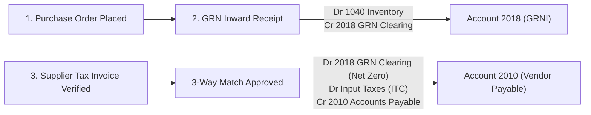
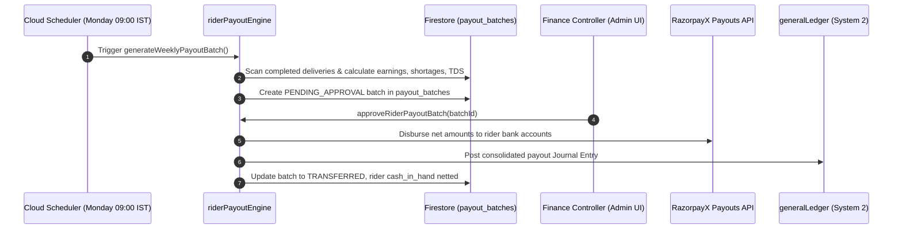
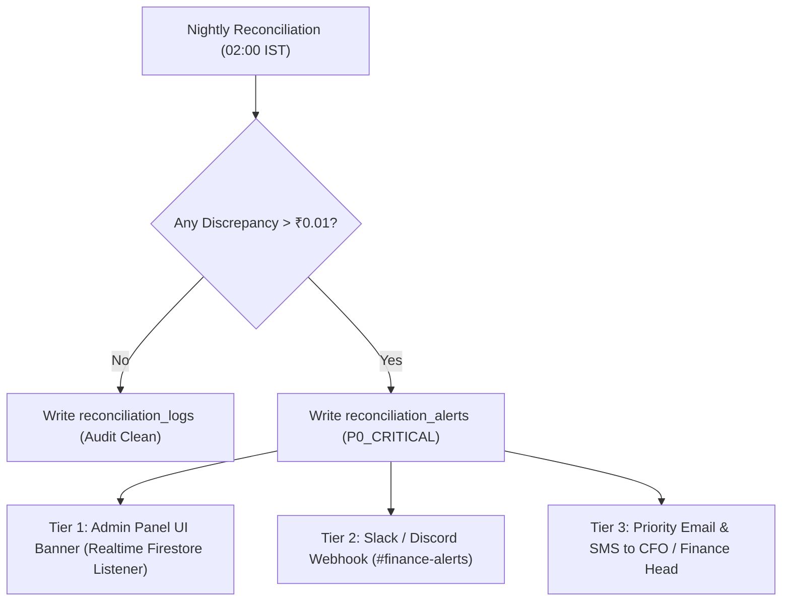
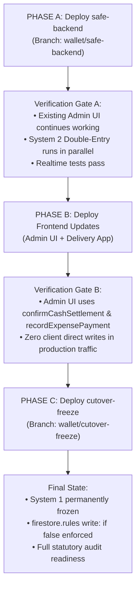

# KrishiVishal Financial Engine — Phase 3 Design Specification (v3.0)
**Document Version:** 3.0.0  
**Branch:** `wallet/design-v3`  
**Base Commit:** `6caac40c` (derived from `wallet/cutover-freeze` & `wallet/safe-backend`)  
**Date:** 2026-10-15  
**Author:** Antigravity Autonomous Pair Programming Agent  
**Audience:** Vishal (Tech Lead), Sanjay Saraf (Statutory Auditor / CA), KrishiVishal Engineering & Operations  

---

## Executive Summary
This document specifies the target architectural design for the remaining financial components of KrishiVishal's statutory Double-Entry General Ledger (System 2). It provides the complete implementation blueprints for:
1. **Quarantine Resolution (Return to Vendor & Scrap Write-off)**
2. **Goods Receipt Note (GRN) Accrual & 3-Way Purchase Match**
3. **Weekly Rider Payout Automation & Section 194C TDS Deductions**
4. **Reconciliation Discrepancy Alerts Observability Pipeline**
5. **Package 6 Frontend Binding Specification & Safe 3-Phase Deployment Order**

Every section concludes with specific **Open Questions for Vishal & CA** that require policy or tax sign-off before code implementation.

---

## 1. Quarantine Resolution (RTV and Scrap) Accounting Design

### 1.1 Context & Problem Statement
Under Phase 1, `inventory/quarantineEngine.js` handled physical stock quarantine during warehouse QC and resolved defective goods through either **Return to Vendor (RTV)** with debit notes or **Write-off / Scrap**. However, its financial recording was wired directly to legacy System 1 (`postLedgerEntry` writing to `ledger` and updating `accounts`). When System 1 was frozen, `quarantine_resolution.test.js` failed with `SYSTEM_1_FROZEN`.

### 1.2 Chart of Accounts Audit
* **Existing Accounts Available:**
  * `1040_INVENTORY` (Current Asset, Normal Balance: DEBIT)
  * `2010_ACCOUNTS_PAYABLE_SUPPLIERS` (Current Liability, Normal Balance: CREDIT)
  * `5010_COGS` (Direct Cost, Normal Balance: DEBIT)
* **Required New Accounts to add to Chart of Accounts:**
  * `1045_INVENTORY_QUARANTINE_ASSET`:
    * Category: `CURRENT_ASSET`
    * Normal Balance: `DEBIT`
    * Description: Value of inventory quarantined during inbound QC or customer returns awaiting vendor return or scrap.
  * `5020_INVENTORY_SHRINKAGE_SCRAP_LOSS`:
    * Category: `DIRECT_EXPENSE` (or `OTHER_EXPENSE`)
    * Normal Balance: `DEBIT`
    * Description: Realized loss from unsalvageable damaged, expired, or spoiled agricultural goods.

### 1.3 Target Double-Entry Journal Entries

#### Stage 1: Inbound QC Defect Intake (Quarantine Isolation)
When goods arrive and fail QC, defective quantity is moved from inward dock to quarantine storage:
* **Dr `1045_INVENTORY_QUARANTINE_ASSET`** (Valuation: Unit PO Cost × Quarantined Quantity)
* **Cr `1040_INVENTORY`** (or `1048_GOODS_INWARD_TRANSIT_GRN` if quarantined prior to general stock intake)
* **Idempotency Key:** `JE_QUARANTINE_INTAKE_${quarantineId}`
* **Memo:** `QC Rejection: Quarantined ${qty} units of SKU ${skuCode} from PO #${poId}`

#### Stage 2A: Return to Vendor (RTV with Vendor Debit Note)
When vendor agrees to accept rejected stock and KrishiVishal issues an official Debit Note:
* **Dr `2010_ACCOUNTS_PAYABLE_SUPPLIERS`** (Reduces statutory liability owed to vendor)
* **Cr `1045_INVENTORY_QUARANTINE_ASSET`** (Relieves quarantine asset from books)
* **Idempotency Key:** `JE_QUARANTINE_RTV_${quarantineId}_${resolutionId}`
* **Memo:** `RTV Settlement: Debit Note #${debitNoteNumber} for ${qty} units of SKU ${skuCode} returned to Supplier ${supplierId}`

#### Stage 2B: Scrap / Damage Write-Off (Scrap Approval)
When defective stock cannot be returned to vendor and warehouse manager scrap resolution is approved:
* **Dr `5020_INVENTORY_SHRINKAGE_SCRAP_LOSS`** (Recognizes direct P&L shrinkage expense)
* **Cr `1045_INVENTORY_QUARANTINE_ASSET`** (Clears asset balance to zero)
* **Idempotency Key:** `JE_QUARANTINE_SCRAP_${quarantineId}_${resolutionId}`
* **Memo:** `Scrap Write-Off: Approved write-off of ${qty} units of SKU ${skuCode} (Quarantine #${quarantineId})`

### 1.4 Open Questions for Vishal / CA
1. **GST Input Tax Credit (ITC) Reversal under Section 17(5)(h):** Section 17(5)(h) of the CGST Act mandates that ITC cannot be availed on goods that are stolen, destroyed, written off, or disposed of. If KrishiVishal previously claimed ITC on purchasing these goods at GRN/invoice time, should Stage 2B (Scrap) automatically generate an ITC Reversal entry:
   * Dr `5020_INVENTORY_SHRINKAGE_SCRAP_LOSS` (Gross cost including reversed tax)
   * Cr `1060_INPUT_CGST` & Cr `1070_INPUT_SGST`?
2. **Vendor Debit Note GST Compliance:** When doing RTV, does KrishiVishal issue a formal Tax Debit Note with GST (reported under Table 9B of GSTR-1), or does the supplier issue a Credit Note to KrishiVishal?

---

## 2. Goods Receipt Note (GRN) Accounting & 3-Way Match Design

### 2.1 The Overlap & Double-Counting Problem
In legacy Phase 1 code:
* `ledger.js:onGoodsReceiptCreated` posted:
  * Dr `INVENTORY_VALUE`
  * Cr `ACCOUNTS_PAYABLE`
* Separately, `supplierLedger.js:recordSupplierPurchaseInvoice` also posted:
  * Dr `INVENTORY_ASSET` / `1040_INVENTORY`
  * Cr `ACCOUNTS_PAYABLE_SUPPLIERS`
If both execute in production, supplier payables and inventory assets are **double-counted** (+200% liability and +200% asset for a single purchase order).

### 2.2 Statutory 3-Way Match Solution (GRN Clearing Suspense)
To comply with Ind AS 2 (Inventories) and statutory accrual accounting, we introduce a dedicated clearing account:
* **New Account:** `2018_GRN_CLEARING_SUSPENSE` (Category: `CURRENT_LIABILITY`, Normal Balance: `CREDIT`). Represents "Goods Received Not Invoiced" (GRNI).

### 2.3 Exact Journal Entry Specifications

#### Event 1: Physical Goods Receipt (`onGoodsReceiptCreated` / `receiveInboundShipment`)
* **Dr `1040_INVENTORY`** (Taxable PO cost of physically accepted goods)
* **Cr `2018_GRN_CLEARING_SUSPENSE`** (Interim accrual for goods received awaiting invoice)
* **Idempotency Key:** `JE_GRN_RECEIPT_${grnId}`
* **Memo:** `GRN #${grnNumber} Inward Receipt: PO #${poId} from Supplier #${supplierId}`

#### Event 2: Vendor Purchase Invoice Matched & Approved (`recordSupplierPurchaseInvoice`)
* **Dr `2018_GRN_CLEARING_SUSPENSE`** (Clears Event 1 interim liability to **₹0.00**)
* **Dr `1060_INPUT_CGST`** (Input GST claimed from supplier invoice)
* **Dr `1070_INPUT_SGST`** (Input SGST claimed from supplier invoice)
* **Cr `2010_ACCOUNTS_PAYABLE_SUPPLIERS`** (Final statutory payment liability owed to vendor)
* **Cr `2040_TDS_PAYABLE_194Q`** (if TDS under Section 194Q applies)
* **Idempotency Key:** `JE_SUPPLIER_INV_${invoiceId}`
* **Memo:** `Purchase Invoice #${invoiceNumber}: 3-Way Match against GRN #${grnId}`

#### Event 3: Price / Quantity Variance Handling
If vendor invoice price differs from PO rate:
* If Invoice > PO: Dr `5030_PURCHASE_PRICE_VARIANCE` (Expense)
* If Invoice < PO: Cr `5030_PURCHASE_PRICE_VARIANCE` (Income/Discount)

### 2.4 Open Questions for Vishal / CA
1. **PO vs Invoice Price Variance Authority:** What is the allowed threshold percentage (e.g., ±2%) for automated variance clearing before requiring CFO manual approval?
2. **Timing of ITC Claim under Section 16(2):** Does CA require vendor invoice booking in the exact same calendar month as the physical GRN, or can GRNI carry forward across financial months on the Balance Sheet?

---

## 3. Weekly Rider Payout Engine, Triggering & TDS Compliance

### 3.1 Weekly Payout Lifecycle Architecture
Rider payout generation is currently only a manual Callable (`generateWeeklyRiderPayouts`). It needs automated scheduling, role-based approval, cash shortage netting, and statutory tax deduction.

### 3.2 Tax Deduction at Source (TDS) Rules under Section 194C
* **Applicability:** Delivery riders operate as independent logistics partners providing transport contracts.
* **TDS Rates:**
  * **Individual / Sole Proprietor:** **1.0%** under Section 194C(1).
  * **Exemption Threshold:** Single contract payment <= ₹30,000 and aggregate annual payouts <= ₹1,00,000.
  * **Non-PAN Deduction:** **20.0%** under Section 206AA if rider has not submitted a verified PAN.
  * **Form 15G / 15H Exemption:** 0% deduction if verified low-income declaration exists.

### 3.3 Target Payout Journal Entry
* **Dr `2015_RIDER_PAYOUTS_PAYABLE`** (Gross delivery fees accrued during delivery fulfillment)
* **Cr `1010_CASH_IN_HAND_RIDERS`** (Netted against un-deposited COD cash held by rider, if permitted)
* **Cr `2045_TDS_PAYABLE_194C_RIDERS`** (Statutory TDS liability to be deposited to Govt of India by 7th of next month)
* **Cr `6040_CASH_SHORTAGE_LOSS`** (Shortage recovered from payout, if applicable)
* **Cr `1030_BANK_CURRENT_HDFC`** (Net bank disbursement via RazorpayX)
* **Idempotency Key:** `JE_RIDER_PAYOUT_BATCH_${batchId}_${riderId}`

### 3.4 Open Questions for Vishal / CA
1. **Contractor (194C) vs Agent (194H) vs Salary (192):** Has CA confirmed that KrishiVishal's rider contracts fall strictly under Section 194C (1% TDS), rather than commission under 194H (5% TDS)?
2. **COD Cash Offsetting against Payout:** Is KrishiVishal legally authorized by the rider contract to net cash-in-hand directly from the rider's weekly earnings before issuing the bank transfer, or must cash handover and payout transfer remain two legally distinct transactions?

---

## 4. Reconciliation Alerts Observability & Monitoring Pipeline

### 4.1 Current Observability Gap
Nightly reconciliation (`reconcileDailyLedgerSchedule` at 02:00 IST) detects discrepancies (> ₹0.01) and writes a document to `reconciliation_alerts` with `severity: "P0_CRITICAL"`. However, no human is alerted, no notification is dispatched, and no Admin panel screen monitors this collection.

### 4.2 Proposed 3-Tier Observability Architecture

### 4.3 Detailed Tier Specifications

#### Tier 1: Admin Panel Dashboard Integration (`KrishiVishal-Admin`)
* **New Page:** `src/pages/FinancialRecon.jsx`
* **Realtime Listener:** Subscribes to `reconciliation_alerts` where `status == 'UNRESOLVED'`.
* **Global App Banner:** If any unresolved P0 alert exists, a persistent red banner appears on the top navigation bar across all Admin screens:
  > 🚨 **CRITICAL: Nightly Financial Discrepancy Detected. Customer Wallet or Rider Cash does not match General Ledger. [View Investigation Dashboard]**
* **Resolution Workflow:** Finance controllers can inspect line-by-line differences, attach bank reconciliation PDFs, and mark alerts as `RESOLVED_WITH_NOTE`.

#### Tier 2: Real-time Webhook Dispatch
* Cloud Function trigger `onDocumentCreated({ document: "reconciliation_alerts/{alertId}" })`.
* Dispatches formatted rich Slack/Teams card with:
  * Discrepancy amounts for Wallet, Rider Cash, and Trial Balance.
  * Direct deep-link to Admin Panel investigation screen.

#### Tier 3: High-Priority Emergency Notifications
* If discrepancy > ₹10,000, trigger transactional SMS / WhatsApp via Twilio/Gupshup and SendGrid email to `cfo@krishivishal.com` and `tech-lead@krishivishal.com`.

### 4.4 Open Questions for Vishal / CA
1. **Designated P0 Emergency Contacts:** Who are the primary and secondary phone numbers / emails to receive urgent 02:00 AM discrepancy alerts?
2. **Auto-Correction vs Manual Approval:** If discrepancy is under ₹1.00 (fractional rounding noise), should the nightly engine automatically book a balancing entry to `6055_ROUNDING_OFF_ADJUSTMENT` and classify the log as `BALANCED_AUTO_ROUNDED`?

---

## 5. Package 6 Frontend & Delivery App Specification with Safe Deployment Order

### 5.1 Admin Panel Specifications (`KrishiVishal-Admin_GITCLONE`)

| File & Location | Current Unsafe Code | Required System 2 Replacement |
|---|---|---|
| `src/pages/CashRecon.jsx:260-275` | Client `writeBatch` to `cash_deposits` and `orders`. | Replace with `httpsCallable(functions, 'confirmCashSettlement')({ settlementId, depositedAmount, shortageAmount, notes, warehouseId })`. |
| `src/pages/RiderWithdrawals.jsx:42-64` | Client `runTransaction` directly mutating `payout_requests` and `riders.pendingSettlement`. | Replace with `httpsCallable(functions, 'approveRiderPayout')({ payoutId, transactionRef })`. |
| `src/pages/Finance.jsx:128, 173` | Subscribes to dead `ledger` collection and executes client `addDoc` to `ledger`. | Replace with `httpsCallable(functions, 'getLedgerSummary')` for metrics, and `httpsCallable(functions, 'recordExpensePayment')` for expense submissions. |
| `src/pages/FinancialRecon.jsx` | *(New Page)* | Realtime monitoring table for `reconciliation_alerts` and `reconciliation_logs` with drill-down audit logs. |

### 5.2 Delivery App Specifications (`KrishiVishalDelivery`)
* `OrderRepository.kt:338-375`: Subscribes to root collection `rider_transactions` where `riderId == currentRiderId` for real-time passbook ledger updates.
* Client-side function `markCashAsDeposited` was deleted completely in commit `95a02101`. Cash handovers are confirmed exclusively by Hub Managers at the physical desk.

### 5.3 Safe 3-Phase Cutover Deployment Order

#### Step 1: Phase A (`wallet/safe-backend`)
1. Deploy Firestore Rules: `firebase deploy --only firestore:rules` (locks only backend-only collections; leaves `ledger`, `cash_settlements`, `payout_requests` open for existing Admin UI).
2. Deploy Backend Functions: `firebase deploy --only functions` (deploys System 2 Double-Entry, `salesLedger`, `walletService`, `confirmCashSettlement`, `nightlyReconciliation`).
3. Verification: System 1 and System 2 run safely in tandem. Zero broken screens for warehouse managers.

#### Step 2: Phase B (Frontend Deployments)
1. Deploy `KrishiVishal-Admin` to Firebase Hosting with HTTPS Callable bindings.
2. Publish Delivery App update to Google Play / internal distribution.
3. Verification: Audit Firestore access logs to confirm that zero client-side `writeBatch` or `updateDoc` calls target financial collections.

#### Step 3: Phase C (`wallet/cutover-freeze`)
1. Deploy Hardened Firestore Rules: Lock `/ledger`, `/accounts`, `/payout_requests`, `/cash_settlements` to `allow write: if false;`.
2. Deploy Frozen Functions: Retire legacy triggers (`onOrderPaidLedger`, `onGoodsReceiptCreated`, etc.).
3. Verification: Run `reconcileDailyLedger` on-demand to confirm 100% balance across customer wallets, rider cash, and trial balance.

### 5.4 Open Questions for Vishal / CA
1. **Frontend Deployment Staging Window:** When can the frontend team commit and deploy the Admin UI branch to staging for desk cashier testing?
2. **In-Flight Order Cutover Handling:** How should in-flight COD orders that were dispatched before Phase A but delivered after Phase C be handled during reconciliation? (The single-writer `riderCashCredited` flag handles this seamlessly).
